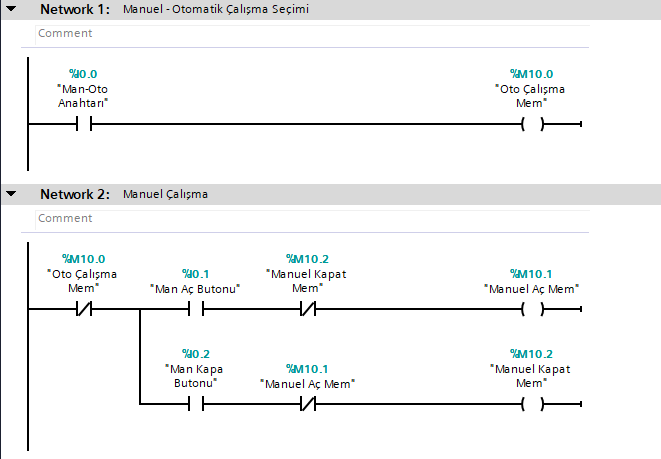
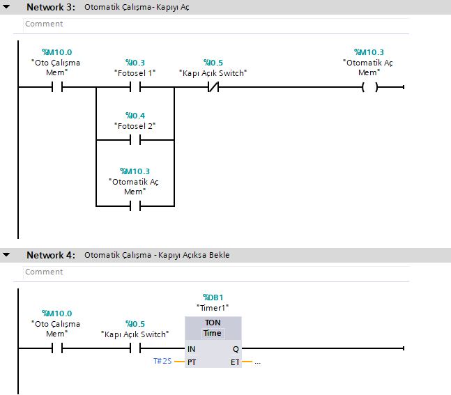
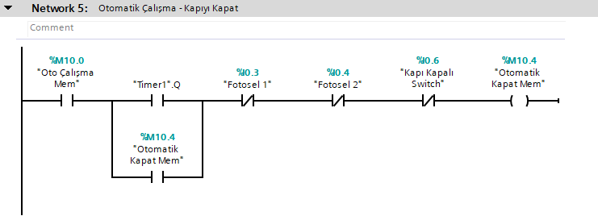
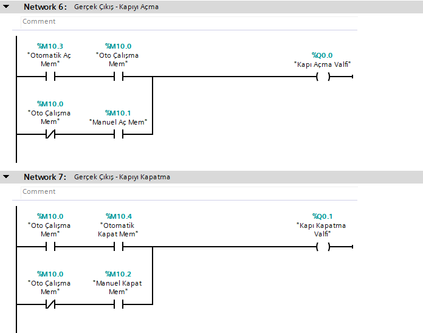

# 🏭 TIA Portal: Otomatik Garaj / Bariyer Kapı Otomasyonu (Manuel & Otomatik Mod)

Bu proje, **Siemens TIA Portal** ve **S7-PLCSim** kullanılarak geliştirilmiş; emniyet fotoselleri, limit switch geri beslemeleri ve otomatik/manuel çalışma modlarına sahip profesyonel bir **otomatik garaj kapısı / bariyer** otomasyon sistemidir.

---

## ⚙️ Sistem Mantığı ve Çalışma Senaryosu
1. **Mod Seçimi:** `Man-Oto Anahtarı` üzerinden sistemin manuel veya otomatik modda çalışması belirlenir.
2. **Manuel Kontrol:** Manuel modda, açma ve kapama butonları birbirine karşı kilitlenerek (`interlock`) güvenli bir şekilde valfleri tetikler.
3. **Otomatik Mod & Fotosel Algılama:** Otomatik modda, fotoseller araç algıladığında ve kapı tam açık değilse sistem otomatik olarak kapıyı açma yönünde harekete geçer.
4. **Otomatik Kapanma (Timer):** Kapı tamamen açıldığında `Kapı Açık Switch` tetiklenir, 2 saniyelik bir bekleme süresi başlar. Süre sonunda fotosellerin önü boşsa kapı otomatik olarak kapanır.
5. **Limit Kontrolleri:** Kapı hareketleri açma ve kapama limit switchleri ile güvenli bir şekilde sınırlandırılmıştır.

---

## 🖥️ Network Adımları ve Görsel Simülasyon

### Network 1 & 2: Mod Seçimi ve Manuel Mod Yönetimi
* **TIA Portal Kodu:**
  
> **Açıklama:** `%I0.0` anahtarı ile otomatik çalışma seçilirken; manuel modda `%I0.1` (Aç) ve `%I0.2` (Kapa) butonları interlock mantığıyla emniyetli yönetilir.

---

### Network 3 & 4: Otomatik Mod - Kapı Açma ve Bekleme Süresi
* **TIA Portal Kodu:**
  
> **Açıklama:** Fotosellerden biri araç algıladığında kapı açma hafızası tetiklenir. Kapı tamamen açıldığında (`%I0.5`) `Timer1` ile 2 saniyelik bekleme süresi başlatılır.

---

### Network 5: Otomatik Mod - Kapıyı Kapatma Senaryosu
* **TIA Portal Kodu:**
  
> **Açıklama:** 2 saniyelik süre dolduğunda ve fotosellerin önü boş olduğunda otomatik kapatma hafızası (`%M10.4`) devreye girerek kapama döngüsünü başlatır.

---

### Network 6 & 7: Gerçek Çıkış Valfleri (Açma / Kapatma)
* **TIA Portal Kodu:**
  
> **Açıklama:** İster manuel ister otomatik kaynaklı olsun, tüm komutlar tek bir paydada toplanarak `%Q0.0` (Kapı Açma Valfi) ve `%Q0.1` (Kapı Kapatma Valfi) fiziksel çıkışlarına aktarılır.

---

## 🛠️ Kullanılan Teknolojiler ve Araçlar
* **PLC Programlama:** Siemens TIA Portal (Ladder Logic - LAD)
* **Simülasyon Ortamı:** Siemens S7-PLCSim
* **Sürüm Kontrol:** Git & GitHub
